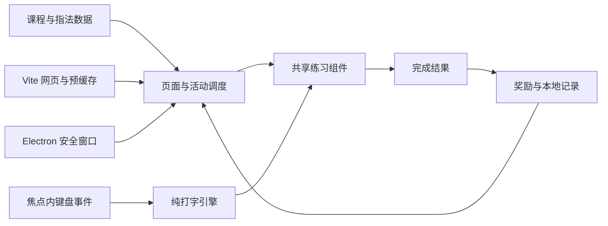
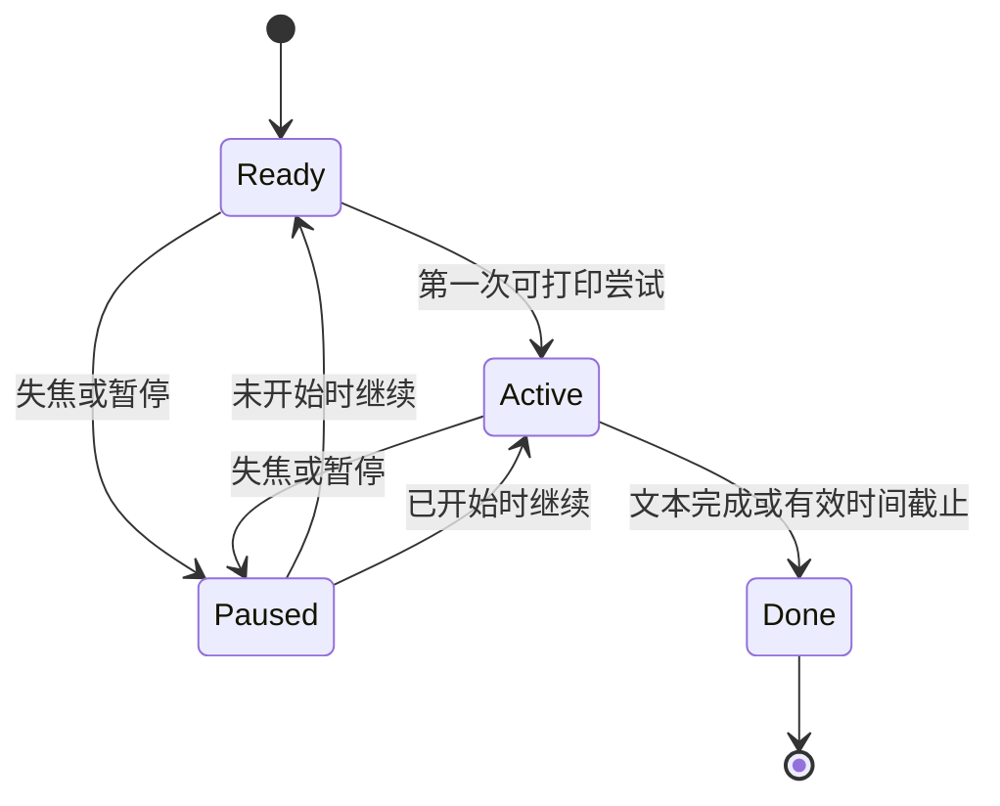

# 设计文档

## 架构与取舍

React + TypeScript + Vite 负责共享前端，Electron 仅提供 Windows 窗口。选择成熟桌面壳以减少双端行为差异，代价是桌面包体积较大。无后端、无 Node 渲染器权限、无自定义 IPC。

## 模块职责

| 模块                                | 核心接口                                                                     | 职责                                         |
| ----------------------------------- | ---------------------------------------------------------------------------- | -------------------------------------------- |
| `src/data/lessons.ts`               | `lessons`、`fingerFor`、`knownKeys`、`practiceText`                          | 课程文本、先修键集、指法、练习素材           |
| `src/lib/typing.ts`                 | `createSession`、`typeKey`、`pause`、`resume`、`expire`、`accuracy`、`speed` | 不依赖 React 的会话状态和计算                |
| `src/lib/progress.ts`               | `loadProgress`、`saveProgress`、`award`、`passedCount`                       | 数据校验、解锁、最佳成绩、去重与保存         |
| `src/components/TypingExercise.tsx` | `Activity`、`onComplete`、`onNext`                                           | 共享课堂、练习和游戏输入，计时器生命周期     |
| `src/components/Keyboard.tsx`       | `target`                                                                     | 键盘位置与手指分工，仅作示意，不模拟成绩输入 |
| `src/App.tsx`                       | `openLesson`、`startLesson`、`navigate`                                      | 顶层视图、教学步骤、设置、离线状态           |
| `electron/main.cjs`                 | `BrowserWindow` 生命周期                                                     | 生产文件加载、导航/权限限制                  |

页面采用显式状态切换，不依赖服务器路由，避免 `file:`、部署子目录和离线刷新产生路由差异。所有课程静态导入，不运行时 fetch 本地文件。

## 输入状态机

输入区域独占焦点时才处理事件，不拦截其他表单或全局快捷键。子按钮冒泡的键盘事件不交给打字引擎，保留空格和 Enter 的原生激活行为。采用 `event.key` 判定输出字符，忽略自动重复、组合输入、非 ASCII 和 Ctrl/Meta/Alt。Shift 影响字母大小写，但本身不计分。退格可以回退，完成态不可再修改。

会话 ID 共用 `createSessionId`：安全上下文优先使用 `crypto.randomUUID`，普通 HTTP 缺少该 API 时使用 `crypto.getRandomValues` 生成 128 位随机 ID。首次完成将焦点交给结果主按钮，保留键盘连续学习。音频恢复和关闭失败均捕获，不影响输入及记录。

时间来自 `performance.now()` 的单调时钟。暂停累加有效时间并清空运行起点；继续时重设起点。`expire` 在定时器刷新、每次输入前以及暂停前调用，防止刷新间隙接受截止后的按键，或截止后先失焦而进入不能自动结束的暂停态。手动暂停、练习区失焦和窗口失焦都传入相同的时长限制。完成回调由会话 ID 和组件完成标记防重。

三个教学阶段：讲解 → 跟练 → 小测。重试创建新会话 ID；跟练完成只进入小测，不发课程奖励。认识键盘课为三个非计时确认步骤。

## 数据模型

1.1 存储键为 `typing-island-v2`，内容版本为 `2`；新键不存在时从 `typing-island-v1` 显式接受并迁移旧版本 `1`，旧键保持不变，避免旧程序覆盖新统计。用户明确重置整个小岛时，先持久化新空记录再清除旧键，失败时提示，防止旧成绩重新出现：

- `lessons`：按课 ID 保存最佳准确率与星级。
- `settings`：声音、减少动态。
- `rounds`、`games`、`seconds`：累计完成次数、游戏次数与有效秒数。
- `days`：本地日历日期到完成次数的映射。
- `recent`：最近 100 个完成会话 ID，用于重复回调去重；不保存原始按键。
- `keyStats`：目标字符到尝试数、正确数的映射，大小写独立。版本 1 迁移时为空；原有字段完整保留，在下一次变更时写入版本 2，不伪造历史统计。退出未完成练习、跟练和认识键盘不写入此统计。

`passedCount` 只计算从第一课连续通过的课程。不能跳过前置课领奖。记录在完成与设置变动后保存，不按键写盘。读取时校验版本、对象类型、非负有限数、课程 ID 与星级一致性。读取异常降级默认状态并提示；写入异常保留内存学习能力并提示。

数据保存在当前 origin/桌面用户配置中；没有跨端同步承诺。更改存储结构必须增加版本及显式迁移，不得直接解释旧 JSON 为新类型。

`parseProgress` 共用于本地读取、写入及备份导入，返回只包含允许字段的规范化对象，剔除额外顶层及嵌套字段。键统计限定单个可打印 ASCII 字符，计数为安全整数，正确数不超过尝试数；足迹日期必须有效，游戏、足迹及课程数量不能超出总次数，课程结果不能跳过先修。会话内按目标键计数，退格不回滚历史，完成时由原去重路径一次合并。

继续练习必须维持导入记录的不变量：累计秒数饱和于最大有限数；总次数已达安全整数上限时，游戏计数与每日足迹冻结，但去重、按键统计和课程结果仍正常处理。成长统计项允许收缩，长数值在自身范围换行，避免合法备份撑开布局。

### 专项复习与备份

`reviewText` 从已通过课程按键中选取至多六个错键，按错误率、错误数及字符顺序确定排序，短文本重复六轮；无错键时退回已学字母热身，零进度只使用 F/J。原有自由练习、游戏素材和课程数据不变，复习使用同一练习组件与计分规则，不关联课程解锁。

备份格式为 `typing-island-backup`、封装版本 `1`，包含导出日期及规范化版本 2 记录；也支持合法版本 1/2 原始记录导入。文件限制 1 MiB，读取后先预览，用户确认才整份替换；取消和错误不改动现有记录。确认时先验证并持久化，成功后才替换内存并退出当前活动，存储失败则保留旧数据。无需后台、IPC 或 Node 渲染器权限；导出通过 Blob 下载，导入使用 File API。

`KeyProgress` 是无外框的统计视图，按小写、大写和符号切换，正确率与样本状态同时使用文字和颜色表达。`RecordBackup` 复用设置弹窗，预览默认聚焦取消，读取期间禁用重复操作；异步读取使用请求标记，关闭弹窗后丢弃过期结果，取消或完成后恢复导入按钮焦点。Blob URL 在组件清理或下一次导出时释放。桌面测试检查临时目录的真实下载文件，不依赖 Electron 的页面下载事件。

离散完成次数校验为非负安全整数，准确率和有效秒数允许小数。同源其他标签页的存储事件经相同读取校验后同步到内存，接收端不重复写回。支持顺序操作的进度、设置与重置同步；不提供多页同时写入的事务隔离，一次只在一个标签页练习。

## 离线和发布

Vite `base: './'` 使资源适应桌面文件和网页子目录。PWA 使用 Workbox 生成预缓存，包含 HTML、JS、CSS、本地插画与字体。图标和插画只由一条缓存收集路径处理，避免同 URL 不同 revision 冲突。离线标记依赖真实入口缓存存在，而不只依赖 Worker 注册成功。

网页首次加载仍需联网和安全来源；缓存可能被浏览器清理。更新采用提示模式，不在孩子练习中强制刷新。Electron `file:` 不注册 Service Worker，全部内容直接从应用包加载。

更新调用的 Promise 拒绝被捕获并显示可重试提示，不更改学习记录；更新成功分支与活动守卫保持原行为。

网页注册前检查 Service Worker 和 Cache API 是否可用；不支持时明确显示在线学习，不停留在离线准备状态。普通 HTTP 可完成练习，但离线缓存仍要求 HTTPS 或 localhost。

桌面采用 `contextIsolation: true`、`sandbox: true`、`nodeIntegration: false`、`webSecurity: true`，拒绝页面外跳、新窗口和权限请求。生产 CSP 通过 Vite HTML 钩子注入，禁止远程脚本和对象，允许本地字体、图片及样式；局部内联样式仅用于进度和角色位置。开发服务器不注入生产 CSP，以允许 React Refresh 的开发内联脚本，且只监听本机。首版不打开外部链接，不接受网页到系统命令的桥接。

桌面主进程处理 `will-prevent-unload`，为未完成练习提供原生退出确认。默认和取消均为“继续学习”；仅明确选择“退出练习”时允许忽略页面的关闭拦截，避免练习中无法关闭窗口。网页仍使用浏览器自身的离开确认。

## 视觉和可访问性

薄荷绿、珊瑚色、暖黄和中性白并用；本地原创小岛与兔兔贯穿游戏和课程。桌面侧栏提供四个固定入口，手机改为底栏。正文采用可读中文系统字体，英文使用本地 Nunito。布局使用断点而不是按视口缩放字体。

动态仅用于伙伴轻微浮动和游戏进度；尊重系统减少动态和站内设置。按键音默认关闭。错误同时用文字、边框和当前字符表示，图标按钮具备名称；设置弹窗限制焦点并支持 Escape 关闭，重置确认替换内容后若焦点丢失则恢复到安全的关闭按钮。触屏仅浏览，不把屏幕按键当作物理指法成绩。

## 测试策略

纯逻辑边界由 Vitest 快速验证；用户流程由 Playwright 在真实 Chromium 中运行；桌面通过 Playwright Electron 启动实际打包产物并检查重启恢复。截图只辅助检查布局，不能代替课程行为、离线刷新和桌面可用性断言。
