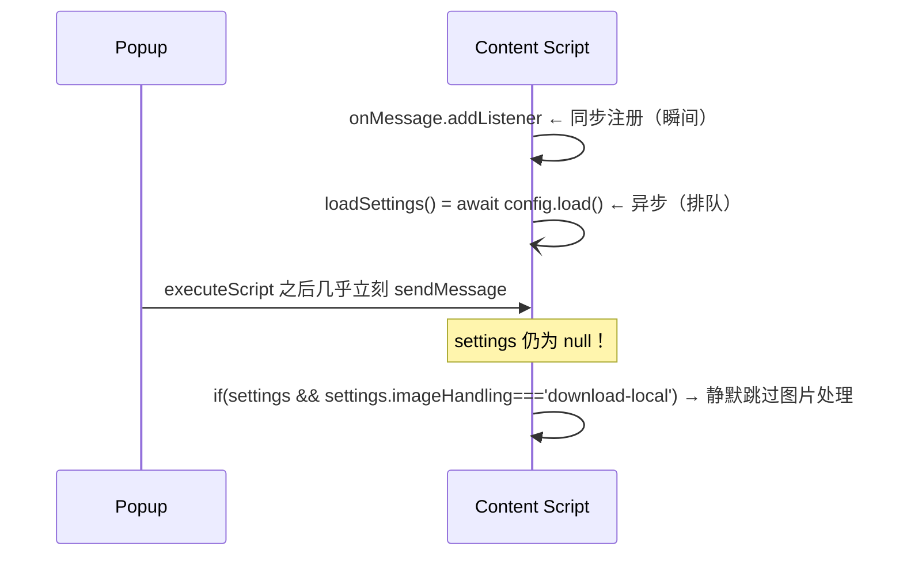
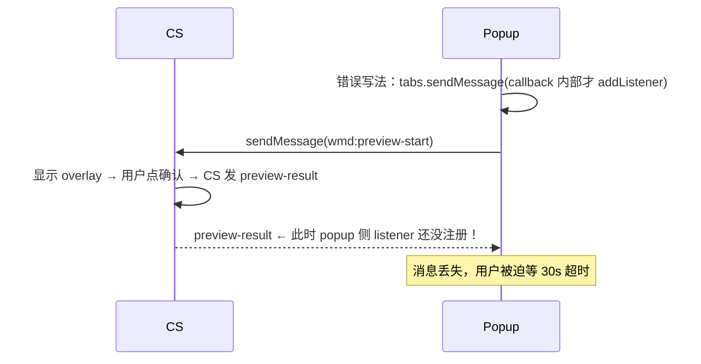

# Dev Log — Web to Markdown

> 每一次实现迭代的设计决策、review 发现、风险记录。**每次迭代都要追加**，作为未来 review 和回溯的依据。

---

## 2026-11-03 · v0.2.0 — 功能扩展 + Review 驱动的竞态修复

### 一、本次做了什么

v0.1.0 → v0.2.0 共新增 7 个功能，改动 9 个文件 + 新增 6 个文件：

| 改动 | 详情 |
|------|------|
| **设置页面** | `options/options.{html,css,js}` + `lib/config.js`，chrome.storage.local 存储 |
| **图片本地化下载** | content → background 消息驱动 `chrome.downloads.download`，相对路径替换 |
| **转换历史** | popup 底部展示，按 URL 去重，可配置条数 |
| **页面高亮预览** | Readability 正文区域高亮 + 确认/取消操作栏 |
| **右键链接转换** | `contextMenus[link]` → `tabs.create` → 等 `onUpdated(complete)` 延迟注入 |
| **Obsidian Front Matter** | YAML 头部：title/date/source/tags/created |
| **数学公式保留** | KaTeX / MathJax / MathML 三种来源还原为 `$...$` / `$$...$$` |
| **代码块语言检测** | HTML class 提取 + 17 种语言内容特征启发式，后处理标注 |
| **标题层级修正** | 正文多 h1 → 非主标题降为 h2 |
| **vitest 单元测试** | 32 用例，覆盖转换管道核心路径 |

### 二、Review 发现的 8 个问题（2 critical / 3 major / 3 minor）

#### Critical-1：Content script settings 异步加载竞态

**影响**：首次 popup 转换时，若用户在设置里开了图片下载，图片处理会被跳过，用户无感知。

**修复**：从"启动时 async IIFE 预加载"改为"消息处理时按需 `await ensureSettings()`"。每次收到需要 settings 的消息都先 await，保证 settings 已 resolve。

#### Critical-2：Preview listener 注册顺序反了

**修复**：`addListener` 在 `sendMessage` 之前。同时用 `done` flag + `clearTimeout(timeoutId)` 做一次性完成保护，所有路径都走 `finish()`。

#### Major-1：Preview overlay 函数大片 dead code

`showPreviewOverlay` 里先创建 `previewHighlight`（定位 + 样式）但从不 appendChild，又删掉刚创建的 previewOverlay 重建一次。最终实际生效的是正文元素 backgroundColor + 蒙层，前 30 行是失败的重构残留。

**修复**：删掉所有临时元素，只保留：蒙层 div + 正文 backgroundColor + 底部操作栏。从 80 行 → 45 行。

#### Major-2：Dead message handler

content.js 里 `wmd:preview-confirmed` / `wmd:preview-cancelled` 两个 handler 无任何发送方。popup 只发 `preview-start`，content 直接发 `preview-result`。属于 copy-paste 设计残留。

**修复**：整段 if 分支删除。

#### Major-3：convertLinkPage 无 newTab null 防御

`chrome.tabs.create` callback 里 `newTab.id` 直接访问，受限 URL 或被浏览器拒绝时 newTab 为 undefined → TypeError。

**修复**：加 `if (!newTab) { notify(); return; }`。

#### Minor-1：无用变量 pageHost

`processImages` 里声明了 `const pageHost = ...` 但后续从未引用。

**修复**：删掉。

#### Minor-2：URL 协议校验缺失

右键 mailto:、tel:、javascript: 链接也会触发 convertLinkPage → 创建无用新 tab → 尝试注入 → 静默失败。

**修复**：`if (!/^(https?:|file:)/i.test(url)) { notify(); return; }` 白名单。

#### Minor-3：超时后新 tab 悬挂

20s 超时后 listener 移除但新 tab 还在那里（active: false）。

**修复**：超时后用 `chrome.tabs.get(tabId)` 检查 tab 是否存在且非 active，若用户还没处理就 auto close。

### 三、风险接受（Trade-off）

| 项 | 说明 | 为什么接受 |
|----|------|-----------|
| `<all_urls>` host_permissions | 用户安装时 Chrome 会弹"允许所有网站"提示 | 图片下载必须有跨域 fetch 权限，无法避开 |
| 图片下载 fire-and-forget | 404/CORS 失败时 Markdown 相对路径指向不存在的文件 | 保持简单，用户若真要图片应在能访问时手动用 wget/aria2c |
| 预览高亮目标 ≠ Readability 结果 | 启发式 CSS 选择器和 Readability 算法选到的区域可能不同 | 属于体验瑕疵，非功能错误，且用户看一眼就能发现不对 |

### 四、验证矩阵

| 阶段 | 结果 |
|------|------|
| npm test | 32/32 全绿 |
| node --check | 6/6 JS 文件语法 OK |
| package.py | 18 个文件 zip 打包成功（58,987 字节） |
| Git 范围锁定 | 9 修改 + 6 新增，无混入其他项目 |

### 五、后续 TODO

- [ ] 侧边栏模式（sidePanel API）— 用户左看网页右改 Markdown
- [ ] 批量多 tab 转换
- [ ] Obsidian callout/admonition 识别
- [ ] ESLint 配置文件落库（当前 package.json 声明了 eslint 但没配 .eslintrc）

---

> 本文件作为每次迭代 review 后追加的 dev log。格式遵循：日期版本 → 做了什么 → review 发现 → 风险接受 → 验证矩阵 → 后续 TODO。
